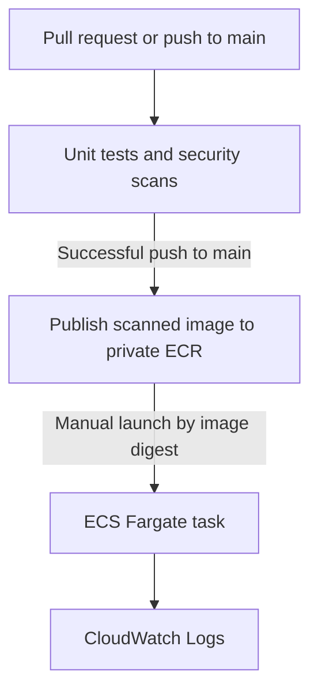

Secure Data Release Lab
This lab demonstrates how to test and scan a Python batch application, publish the scanned container image to private Amazon ECR, and verify a one-off run on Amazon ECS Fargate. GitHub Actions automates validation and publishing. The Fargate run was launched manually from the AWS console and verified in ECS and CloudWatch Logs.
Application
app.py counts records with the statuses received and processed. It raises a ValueError for unsupported statuses. The sample input is built into the application, so the demo needs no external data source. test_app.py covers the expected counts and rejection of an unsupported status.

The Dockerfile uses python:3.14.10-alpine, removes pip from the runtime image, and runs the application as UID and GID 10001. The application prints its summary and exits, which fits a standalone ECS batch task.
Release workflow

Control	What the workflow checks or enforces
Python unit tests	Verify record counts and rejection of unsupported statuses.
Bandit	Scans app.py for common Python security issues.
Gitleaks	Scans the checked-out repository files for secrets and redacts findings in the output.
Trivy	Scans the exported container image for vulnerabilities. High or critical findings fail the job.
Artifact promotion	Uploads the same Docker archive that Trivy scanned as scanned-container-image. The publish job downloads and loads that archive.
Release gate	The publishing job depends on the validation job and runs only for a successful push to main.

The publishing job tags the image with the Git commit SHA, workflow run ID, and run attempt. It then pushes to ECR and queries the registry for the image digest. The lab's ECR repository uses immutable tags.

[View the workflow](.github/workflows/ci.yml)
AWS identity and permissions
Identity	Purpose
PushSecureDataReleaseImage	GitHub Actions assumes this IAM role through OIDC to authenticate to ECR, push the image, and query its digest.
SecureDataReleaseTaskExecutionRole	ECS uses this execution role to pull the private ECR image and send container logs to CloudWatch.
Application task role	The sample application works with in-memory records and runs without an application task role.

The publishing job requests an OIDC token with id-token: write. The IAM trust policy restricts role assumption to this repository's main branch using GitHub's owner and repository IDs in the subject. The workflow reads the publishing role ARN from the AWS_ECR_PUSH_ROLE_ARN repository variable and obtains temporary AWS credentials through OIDC.
Run locally
From the repository root with Python 3.14 and Docker installed, run the tests, build the image, and start the batch container.
python3 -m unittest -v
docker build -t secure-data-release-lab:local .
docker run --rm secure-data-release-lab:local
Expected container output:
{'received': 2, 'processed': 1}
Reproduce the Fargate verification
1. After a successful main publish, copy the digest reported by ECR. Use the image URI in the form REGISTRY/secure-data-release-lab@sha256:DIGEST in the task definition.
2. Configure a Fargate task definition for Linux/x86-64 with awsvpc networking and the task execution role. Configure the awslogs driver to use /ecs/secure-data-release-lab in us-east-1.
3. Run one standalone task in the secure-data-release-lab cluster. Use a subnet that can reach ECR and CloudWatch Logs. The lab used a public subnet with a public IP and a dedicated security group with zero inbound rules and outbound HTTPS.
4. In the ECS task details, compare Image Digest with the ECR digest. Confirm the container exits with code 0 and check the Logs tab for the expected summary. A successful one-off batch task reaches Stopped after its process finishes.
Verification evidence
Evidence	Observed result
Original ECR publishing job	The scanned image was published to private ECR.
Fargate task	Task 8508cdd613d341f1b72d1ecbda4d09d9 ran task definition secure-data-release-lab:1 and reported exit code 0.
ECR and ECS image digest	sha256:7a723f2394f6e202857832d7b64b5c7540bd2eaa8db64f59494654b0902cc70f
CloudWatch log event	{'received': 2, 'processed': 1}
Post-upgrade publishing job	actions/download-artifact@v7 successfully downloaded the archive, its checksum matched, and the ECR publish step passed.

The GitHub artifact checksum validates the downloaded archive. The ECR image digest identifies the container image selected by ECS. The manual Fargate evidence above comes from the original release. Run #22 separately verifies the publishing workflow after the artifact action upgrade.
